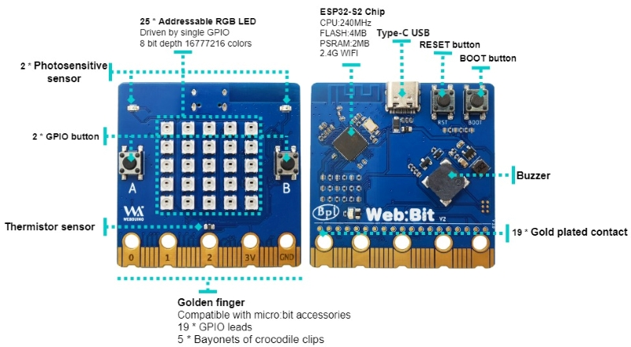
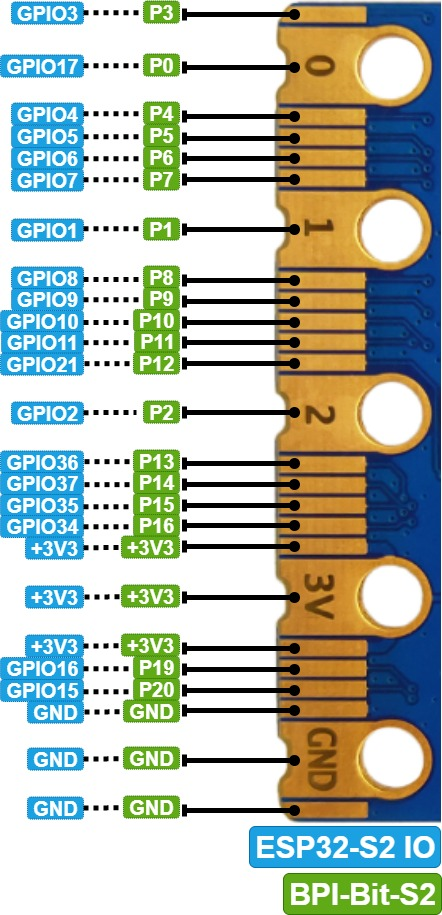

# Exp16 — BPI-Bit-S2 CircuitPython display + PlanetX buttons

Async MakeCode-style **5×5 LED** library and **per-module button** dispatchers (`OnboardButtons` A/B, `PlanetXButtonSensor` C/D) for the [BananaPi BPI-Bit-S2](https://docs.banana-pi.org/en/BPI-Bit-S2/BananaPi_BPI-Bit-S2).

Display architecture: [`lib/display/README.md`](lib/display/README.md).


## Hardware



<sub>BananaPi BPI-Bit-S2 hardware; unmodified source: [BananaPi docs](https://docs.banana-pi.org/en/BPI-Bit-S2/BananaPi_BPI-Bit-S2), available under Creative Commons Attribution-ShareAlike License, by BananaPi. (local [license file](Notes/bpi_bit_v2_interface_en.jpg.license))</sub>


| Piece | Detail |
|-------|--------|
| Board | [BPI-Bit-S2](https://circuitpython.org/board/bpi_bit_s2/) (ESP32-S2, micro:bit form factor) |
| Firmware | Stock CircuitPython **10.3.0**, board-id `bpi_bit_s2` |
| LEDs | Onboard 5×5 WS2812 (25 NeoPixels), `board.NEOPIXEL` (GPIO18), brightness cap 0.20 |
| Wiring | Column-major, right-to-left. Logical (0,0) = top-left. Strip index `row + 20 - column * 5` |
| Buttons A/B | Onboard, `board.BUTTON_A` / `board.BUTTON_B` (active-low) |
| Buttons C/D | [ElecFreaks PlanetX Push Button Module](https://wiki.elecfreaks.com/en/microbit/sensor/planet-x-sensors/Plant_X_EF05017/) on Nezha2 **J3** (P13/P14) = `board.IO13` / `board.IO14`. Port map: `planetx.J1`–`J4`. |
| Nezha2 I2C | All IIC interface ports share one bus: silk **P19 = SCL**, **P20 = SDA** (`board.SCL` / `board.SDA`). `planetx.I2C`. |

### Port mapping from Nezha2 interfaces → `board.IOn` (the BPI-Bit-S2's CircuitPython name for goldfinger pin)



<sub>BananaPi BPI-Bit-S2 goldfinger pinout; unmodified source: [BananaPi docs](https://docs.banana-pi.org/en/BPI-Bit-S2/BananaPi_BPI-Bit-S2), available under Creative Commons Attribution-ShareAlike License, by BananaPi. (local [license file](Notes/bpi_bit_v2_goldfinger.jpg.license))</sub>

The figure above shows the edge-connector pins by their silk **P-number** (the BBC micro:bit edge-connector
standard this board's connector, "goldfinger", implements). Nezha2 wires its RJ11 ports to those same
P-numbers; `lib/planetx/ports.py` carries that same wiring as code (`J1`–`J4`, `I2C`) and binds each P-number
to its `board.IOn` object:

| Nezha2 port | Edge-connector pins (P-number) | CircuitPython pin |
|-------------|---------------------------------|--------------------|
| J1 (GPIO) | P1, P8 | `board.IO1`, `board.IO8` |
| J2 (GPIO) | P2, P12 | `board.IO2`, `board.IO12` |
| J3 (GPIO) | P13, P14 | `board.IO13`, `board.IO14` |
| J4 (GPIO) | P15, P16 | `board.IO15`, `board.IO16` |
| IIC (any of the 4 ports — shared bus) | P19 (SCL), P20 (SDA) | `board.IO19` / `board.SCL`, `board.IO20` / `board.SDA` |

`board.IOn` names the goldfinger pad P*n*, **not** the raw ESP32-S2 wire number — see the comment block
at the top of `lib/planetx/ports.py` if you need that extra layer.

## This experiment's setup

These libraries are not tied to macOS or a particular Python virtual environment. Host tests need a desktop CPython with `pytest` and `pytest-asyncio`. Do not treat Blinka `board`/`keypad` as CircuitPython.

So far, I used for development: Cursor on macOS 26, CPython 3.13 in a virtual environment at `<path-to-venv>`. Do not pip-install `neopixel` or `adafruit_bitmap_font` into that venv (host tests stay off `display.core`).

On a BPI-Bit-S2 this experiment uses CircuitPython 10.3.0 (`neopixel` frozen, `keypad.Keys` built in). User-facing `asyncio` is a **bundle** library: `circup install asyncio` (pulls `adafruit_ticks`). Host CPython `asyncio` is a different library.

## Tests

From this folder, using that host CPython (not CircuitPython on the board). The suite does not use a physical board. `test_display_core_host.py` loads `display.core` behind stubs; the other tests do not import it.

```bash
<path-to-venv>/bin/pytest
```

Needs `pytest` and `pytest-asyncio` on that interpreter. Concrete path for this machine: [`tests/README.md`](tests/README.md).

## Deploy

Human-run deploy scripts (host → mounted CIRCUITPY drive; the board is a deploy target, never the source of truth):

1. Flash CircuitPython 10.3.0 ([board page](https://circuitpython.org/board/bpi_bit_s2/); 4 MB Espressif needs TinyUF2 ≥ 0.33.0 if using UF2).
2. When the CIRCUITPY drive mounts, ship the libraries: `python3 scripts/sync_lib_to_board.py` — filtered copy of `lib/` (excludes `__pycache__/`, `.DS_Store`, `README.md`, `*.pyc`; skips unchanged files by size+mtime; never deletes board files). Also ships the vendored `asyncio/` + `adafruit_ticks.mpy`, so no `circup install` step is needed.
3. Ship the code: `python3 scripts/sync_files_to_board.py` — copies the `.vscode/cpfiles.txt` entries whose board bytes differ, and skips a file whose bytes already match (`--force` rewrites). Currently `readme.txt` plus a `code_stageN.py -> /code.py` replay line. **Switching which script is active**: edit `.vscode/cpfiles.txt` directly — comment out the currently-active `... -> /code.py` line, uncomment (or add) the one you want, then re-run the sync script. Exactly one `-> /code.py` line must be active at a time; the manifest's own header comment documents the full syntax and a real gotcha (a trailing inline comment on an active line silently corrupts the destination filename instead of erroring).
4. The board auto-reloads after each copy batch — batch changes into as few sync runs as possible.

The same two copies are the Run Task entries **Sync Lib to Board** and **Sync Files to Board**. The CircuitPythonSync extension's "CP Copy Files to Board" copies whichever workspace folder is selected. Its "CP Copy Libs to Board" is **not** used here: it copies all of `lib/` with no exclusions, and it runs `dot_clean` across the live drive.

Clean-slate reset (destructive): `import storage; storage.erase_filesystem()` at the board REPL — the verified-clean path. Do **not** host-side-delete `lib/` on the live volume, and never cancel a copy mid-flight (if one stalls, eject cleanly and inspect before further writes).

The vendored `adafruit_ticks.mpy` and `asyncio/` are what the board runs. Those files identify themselves as `adafruit_ticks` 1.1.5 and `asyncio` 3.0.3. [`requirements.txt`](requirements.txt) lists 1.1.7 and 3.1.1 and does not match them. Re-download from the Adafruit Community Bundle if the `.mpy` files are lost.

## Status

On UID `0740D10F1BE9`, CircuitPython 10.3.0:

- **2026-11-22.** Stages 0 and 1 of the current display API. On a blue fill, brightness 0.02 is still a very dim blue and 0.01 is off.
- **2026-09-13.** Stages 0–2 (steps 1–10) and Stage 3, on the API of that day. Stages 2 and 3 have not been re-run on the current API.

`OnboardButtons().button_a.on_pressed(...)` and `PlanetXButtonSensor(port=J3).button_c.on_pressed(...)` are the current button calls. `on_pressed(None)` clears a handler. `code_stage3.py` uses them; that script has not been confirmed on the board since the call shape changed. Stage 2 parts A–C matched on the board, including the `"STAGE2"` and `"42"` marquees. `"!!"` is not in that script. `.vscode/cpfiles.txt` chooses which stage script is copied to `/code.py`.

Student-API stability target (5×5 → later 8×8): [`Notes/student-api-portability.md`](Notes/student-api-portability.md).

## Folder structure

```
lib/display/       5×5 display package (fork of Exp14; work here, not in Exp14)
lib/buttons.py      Async onboard buttons (`Button`, `OnboardButtons`): one handler per press and per release
lib/planetx/        PlanetX modules (`J1`–`J4` GPIO interface ports; shared `I2C` bus; `PlanetXButtonSensor` C/D)
code_stage0-4.py    Stage scripts (which one runs: `.vscode/cpfiles.txt`). Current API: Stages 0 and 1, and Stage 2 parts A–C, confirmed 2026-11-22. Stage 3 is not confirmed yet. Stage 4 is the PlanetX driver smoke and is not in the manifest.
scripts/            Human-run deploy + font-build scripts (see § Deploy)
.vscode/            Per-experiment CircuitPythonSync config + tasks.json + cpfiles.txt
tests/              Host pytest (no physical board); see tests/README.md
Notes/              Human spec + BananaPi photos (CC BY-SA, unmodified)
```

A local `ai-notes/` folder may exist as a gitignored working store; this tree does not depend on it.

## Further reading

| What | Where |
|------|--------|
| Display package architecture | [`lib/display/README.md`](lib/display/README.md) |
| Host tests (local interpreter path) | [`tests/README.md`](tests/README.md) |
| Spec / working prefs | [`Notes/overall_goal.md`](Notes/overall_goal.md) |
| Student-API portability (5×5 → 8×8) | [`Notes/student-api-portability.md`](Notes/student-api-portability.md) |
| Exp14 vs. Exp16 `lib/display/` divergence (maintainer-facing) | [`Notes/exp14-divergence.md`](Notes/exp14-divergence.md) |
| Goldfinger pinout (CC BY-SA) | [`Notes/bpi_bit_v2_goldfinger.jpg`](Notes/bpi_bit_v2_goldfinger.jpg) |
| Board interface photo (CC BY-SA) | [`Notes/bpi_bit_v2_interface_en.jpg`](Notes/bpi_bit_v2_interface_en.jpg) |
| Firmware | [circuitpython.org/board/bpi_bit_s2](https://circuitpython.org/board/bpi_bit_s2/) |

### ElecFreaks PlanetX / Nezha — protocol sources (not CircuitPython)

Vendor code for **micro:bit MicroPython** and **MakeCode (PXT)**. Do not import these into this experiment. They are the working references for GPIO maps, I2C command bytes, and per-module read/write sequences when adding further PlanetX sensors, Nezha motors/servos, or other ElecFreaks expansion hardware.

Checked 2026-09-14: the two `pxt-*` repos **are** MakeCode extensions (`pxt.json` `supportedTargets: ["microbit"]`, TypeScript, installable from the MakeCode editor).

| Runtime | Repo | What it shows |
|---------|------|----------------|
| MicroPython (`from microbit import *`) | [PlanetX_MicroPython](https://github.com/elecfreaks/PlanetX_MicroPython) | PlanetX sensors + Nezha: RJ11 pin maps (J3 → P13/P14 for C/D), pull-ups, per-module I/O. README: 行星传感器和哪吒的micropython模块 |
| MicroPython | [EF_Produce_MicroPython](https://github.com/elecfreaks/EF_Produce_MicroPython) | Expansion-board products: Nezha / Nezha V2 I2C motor protocol (`0x10`), Cutebot, Wukong, … |
| MakeCode (PXT) | [pxt-PlanetX](https://github.com/elecfreaks/pxt-PlanetX) | Official PlanetX sensor extension (`pxt.json` name `pxt-PlanetX`, v1.6.5) |
| MakeCode (PXT) | [pxt-nezha2](https://github.com/elecfreaks/pxt-nezha2) | Official Nezha V2 extension (`pxt.json` name `pxt-nezha2`, v1.2.6) |
