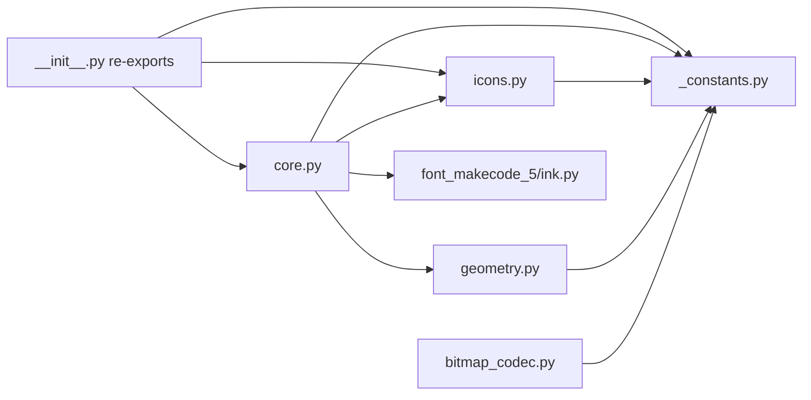

# `display` package — architecture and design

Developer-facing architecture doc for the ``lib/display/`` package.
For install + usage see the project root [README.md](../../README.md).

## Purpose

MakeCode-style Python display library driving a 5x5 WS2812 NeoPixel
matrix from a BPI-Bit-S2 running CircuitPython 10.3.0.

## Hardware context

| Component | Detail |
|-----------|--------|
| MCU board | BPI-Bit-S2 (ESP32-S2, micro:bit form factor) |
| LED matrix | 5x5 WS2812 (25 NeoPixels, onboard) |
| Data pin | ``board.NEOPIXEL`` (GPIO18) |
| Wiring | Column-major, right-to-left; strip index 0 = top-right. Formula ``idx = row + 20 - column * 5``. |
| Brightness cap | 0.20 inside the library |

The library hides the physical wiring behind a pre-computed coordinate
LUT (see [geometry.py](geometry.py)); callers use logical coordinates
with origin (0, 0) at top-left.

## Two-tier API

**Tier 1 — synchronous rendering primitives** (immediate writes to the
NeoPixel buffer; no ``await``):

Every method that draws a picture takes an optional display column `start_col` (an integer, default 0, the left-most column) where the picture's first
column goes. Always pass it by name, for example `start_col=2`; passing it without the name raises `TypeError`. A positive value moves the picture to the right (`start_col=2` leaves columns 0 and 1 off). A negative value moves it to the left,
partly off the screen (`start_col=-2` cuts off the picture's first two columns). Columns that land outside the matrix are cut off, and LEDs the
picture does not reach are off. A float or a bool raises `TypeError` before the display changes.

- `render_pattern(pattern, color=WHITE, *, start_col=0)` — parse-and-render a
  `#`/`.` grid string or palette dict.
- `render_icon(icon, color=WHITE, *, start_col=0)` — render an `Icon` (e.g. `Emojis.HEART`). `Icon` carries no color of its own; `color` is the render color, not an override.
- `render_arrow(arrow, color=WHITE, *, start_col=0)` — alias of `render_icon` for an `Icon` from the arrow catalog (e.g. `Arrows.NORTH`), kept as a separate public method name.
- `render_image(image, *, start_col=0)` — render a `WIDTH`-column window of an `Image`, in the image's own colors.
- `render_string(text, color=WHITE, *, start_col=0)` — draw text starting at column `start_col` (`start_col=0` is the left-most LED) and leave it lit.
  Text wider than the screen shows the beginning and crops the end. An empty string draws a blank screen.
  `centered(text)` centers text. The call does not pause.
- `render_number(n, color=WHITE, *, start_col=0)` — draws `str(n)` like `render_string`.
- `set_pixel(x, y, color)` / `render_filled(color)` / `clear()` /
  `get_pixel(x, y)`.
- `set_brightness(value)` / `set_rotation(degrees)`.

**Lifecycle:**

- `deinit()` — release the data pin / RMT peripheral. Cancels any
  ongoing animation, then deinitializes the NeoPixel buffer; *this
  instance* is unusable afterwards (no re-init path on it), but the pin
  is now free for a newly-constructed `Display()`. See [Singleton design &
  `deinit`](#singleton-design--deinit) below.

**Tier 2 — async MakeCode-compatible methods** (require
`await`, cancellable):

All times are integers in milliseconds: `float` or `bool` raises `TypeError`, negative value raises `ValueError`, both
before the display changes. To convert a `float`, write `int(1000 / 3)` or use integer division `1000 // 3`; both drop the fraction (truncate).

- `show_pattern(pattern, color=WHITE, *, start_col=0, duration_ms)` / `show_icon(icon, color=WHITE, *, start_col=0, duration_ms)` /
  `show_arrow(arrow, color=WHITE, *, start_col=0, duration_ms)` / `show_image(image, *, start_col=0, duration_ms)` /
  `show_filled(color=WHITE, *, duration_ms)` / `show_string(text, color=WHITE, *, start_col=0, duration_ms)` /
  `show_number(n, color=WHITE, *, start_col=0, duration_ms)` — draw, hold for `duration_ms`, then blank. Always pass the hold time parameter
  by name, for example `duration_ms=1000`. Without the name the call raises `TypeError`. The picture stays up for
  the hold duration. If another display call takes over during the hold, the `show_*` call returns at that point, within 47 ms and not only
  after the full hold, leaving the display to the other caller. With `duration_ms=0`, the call draws, lets other ready tasks run once, and then
  wipes the display (if no other call has taken over). This is probably just a short flicker.
  Text or a number wider than the screen is cut off; to scroll, use `scroll_string` / `scroll_number`.
- `scroll_image(image, *, interval_ms=150, loop=False, blank_edges=True)` /
  `scroll_string(text, color=WHITE, *, interval_ms=150, loop=False, blank_edges=True)` /
  `scroll_number(n, color=WHITE, *, interval_ms=150, loop=False, blank_edges=True)` — move the picture left across the display,
  one column every `interval_ms`. With `blank_edges=True` it enters from the right-most LED and the display ends empty. With
  `blank_edges=False` it starts with the first column on the left-most LED and stops when the last column reaches the
  right-most LED (a picture no wider than the display does not move: its first frame is also its last). A scroll ends on its last frame,
  which stays on the display until another call replaces it. With `loop=True` the scroll repeats until another display call takes over,
  and only then does the scroll call return (leaving the display to the other caller). `interval_ms=0` still lets other ready tasks run once
  between frames. For a letter that stays lit, call `render_string`.
- `pause(duration_ms)` — cancellable async sleep; returns early if a later
  display call supersedes this one first.
- `repeat_until_cancelled(callback, sleep_between_ms=10)` — an `async` helper that calls
  `callback` again and again. It ends only when its task is cancelled; display takeover does not stop it.
  `callback` is a function with
  no arguments, either a normal `def` or an `async def` (it is awaited).
  After each callback execution it rests `sleep_between_ms` milliseconds so your other
  tasks get a turn, such as button handlers. Start it with
  `asyncio.run(display.repeat_until_cancelled(my_function))` at the top of your program, or
  `await display.repeat_until_cancelled(my_function)` inside another `async def`.
  A `sleep_between_ms` that is not an integer raises `TypeError`, and a negative one raises `ValueError`.

A fixed letter, a scrolling string, and a picture that stays up:

```python
display.render_string("A")
await display.scroll_string("Hello")
token = await display.show_icon(Emojis.HEART, duration_ms=2000)
if token.is_expired:
    display.render_string("!")
```

`render_string("A")` stays until the next display call. `scroll_string("Hello")` scrolls and, with the default `blank_edges=True`, ends on a blank screen. With `blank_edges=False` a scroll ends on its last frame, which stays lit; to clear it afterwards, check the returned token first: `if not token.is_expired: display.clear()`. The heart stays up for the 2000 ms hold and is then wiped. When `token.is_expired` is true, another display call took over during the hold (so nothing was wiped), and the example then draws the `!`.

## Cooperative multitasking & `Token`

`Token` (`__slots__ = ("_is_expired",)`) is a self-contained cancellation
marker — no back-reference to `Display`, no sequence number to compare.
`is_expired` is a read-only property backed by `_is_expired`; only
`Display._acquire()` (module-internal) writes it, so a `Token` is
immutable from outside `core.py`. `_acquire()`, called internally by
every display-mutating method, expires the *previous* token in place
(`self._token._is_expired = True`), mints a fresh one, stores it, and
returns it.

Every **Tier 2** method returns the `Token` its own `_acquire()` call
produced, so any caller can check `token.is_expired` afterwards. **Tier
1** methods (and `deinit`) do not return a token — there is nothing to
`await` after them, so a caller couldn't have anything meaningful to
check for cancellation against. A Tier 2 method that renders via a Tier
1 method (e.g. `show_pattern` → `render_pattern`) reads `self._token`
right after that call to recover the token its internal `_acquire()` minted.

Tier 2 animations capture the token at start and re-check
`token.is_expired` between frames. This lets a new render cancel an
ongoing scroll without explicit task cancellation; the scroll coroutine
simply returns early, returning the (now-expired) token, so the caller
can tell the two cases apart.

**Holds** (`pause` and the waits after `show_pattern` / `show_icon` /
`show_arrow` / `show_image` / `show_filled` / `show_string` / `show_number`)
use `core.py`'s `_sleep_pollable(token, total_ms)` instead of a single bare
`await asyncio.sleep_ms(...)`. The `show_*` methods hold through
`Display._hold_then_blank(token, duration_ms)`: wait, then wipe the display,
unless a later call took the display. `_sleep_pollable`
is a free function — it takes a
`Token` and has no dependency on any `Display` instance's state — that
chunks the wait into 47 ms pieces and
returns as soon as `token.is_expired`, so a hold notices a superseding
display operation within 47 ms rather than only after its full
duration has elapsed. `_sleep_pollable` takes whole milliseconds and tracks a
ticks deadline (`ticks_add(ticks_ms(), total_ms)`), not a chunk-size
countdown, so scheduling jitter across many chunks cannot accumulate
drift — the non-cancelled total wait ends close to `total_ms`, usually slightly later (other coroutines run until their next `await`).
A `total_ms` of 0 pauses once, via `asyncio.sleep_ms(0)`, then returns. Every hold awaits at least once, also for very small values. During that pause, other coroutines that are ready get a chance to run — a button check, a sensor read, another animation — before this hold continues. A synchronous Tier 1 method returns in the same call, so those other coroutines wait until the caller itself pauses.

Discipline: always `await asyncio.sleep_ms(...)` between frames in Tier 2
methods, and check `token.is_expired` on both sides of the await.

Note: as of this writing, callers must branch on `token.is_expired` after
every chained call if they want a stale sequence to stop drawing —
tokens aren't yet accepted back in as an argument to make that automatic
(see `ai-notes/design/tier2-cancellation-semantics.md` for the open
follow-up).

## Rotation during an in-flight Tier 2 animation

`set_rotation` does **not** cancel a running animation (`set_brightness`
does not either; see the cancellation-policy exceptions above). It also
redraws the frame that is already on the LEDs: logical colors are copied
out through the old LUT, the LUT is rebuilt, and those colors are written
back through the new LUT, then `show()` once. The copy uses a pre-list allocated
in `Display.__init__`. There is no `await` in that rewrite, so it finishes
between two frames of an in-flight scroll. The scroll's next frame is drawn
with the new LUT as well.

That combination is safe by construction — these facts compose into a
mechanical guarantee:

1. **In-place LUT mutation.** `set_rotation(degrees)` rebuilds this
   `Display` instance's coordinate LUT *in place*: `build_lut(degrees,
   dest=self._lut)` (see [geometry.py](geometry.py)) writes the new table
   directly into the existing `self._lut` `bytearray`. Any code holding a
   reference to `self._lut` sees the update immediately, with no
   cache-invalidation step needed.
2. **Fresh LUT read every frame.** Every render primitive — `Display._render_ring_window`
   (`scroll_string` / `scroll_number`), `Image._render_window` (`Display.render_image` /
   `show_image` / `scroll_image`), `Display._render_colmajor` (icon/arrow renders) — reads
   `self._lut` fresh on **every call**, not once at animation start and
   cached for the animation's duration. A long-running scroll therefore
   never has a "stale" LUT to invalidate; it just picks up whatever
   `self._lut` currently contains, frame by frame.
3. **Cooperative-scheduler atomicity.** CircuitPython's bundled
   `asyncio` is single-threaded and cooperative — nothing preempts a
   running coroutine mid-statement, only at an explicit `await`.
   `build_lut`'s rebuild loop contains no `await`, so a `set_rotation`
   call always runs to full completion strictly between two
   frame-renders of any in-flight animation, never interleaved with one.

Together: **a rotation issued while a Tier 2 animation is in flight
cannot corrupt a frame or the animation's own state.** `scroll_string`'s
ring-buffer `read_head` / feeder position and `scroll_image`'s
window position live entirely in the coroutine's own stack frame — rotation never
touches them. The current frame is shown again through the new LUT, and the
next frame uses that LUT too. The animation's logical progress is unaffected,
and a scroll's screen-relative direction/axis can change mid-scroll
(e.g. a 90°/270° rotation swaps a horizontally-scrolling animation onto
the vertical axis, since it swaps which logical axis maps to which
physical one — see [geometry.py](geometry.py)'s rotation cases) without
restarting or glitching it.

This is a **code-level, argued** guarantee (in-place mutation +
read-fresh-every-frame + scheduler atomicity), not one derived from
watching it run: static-rotation correctness and scroll-mechanics
correctness have each been confirmed on-device independently, but their
*combination* — rotating while a scroll or `Display.scroll_image` animation
is actually in flight — is, as of this writing, still pending a dedicated
on-device confirmation (see the project's test plan / session memory).

## Column-major bytes (monochrome bitmap format)

Icons, arrows, font glyphs, and mono Images all share the same internal layout: one byte per column
(column 0 = leftmost). Within each byte, bit N has numeric value 2^N (so bit 0 is the least-significant bit)
and indicates row N is lit (row 0 = top). An 8x8 mono bitmap is therefore exactly 8 bytes.

For example, let's consider letter `F`:

```
. # # # # # # .          col 0: . . . . . . . .  -> 0x00
. # . . . . . .          col 1: # # # # # # # .  -> 0x7F
. # . . . . . .          col 2: # . . # . . . .  -> 0x09
. # # # # . . .          col 3: # . . # . . . .  -> 0x09
. # . . . . . .          col 4: # . . # . . . .  -> 0x09
. # . . . . . .          col 5: # . . . . . . .  -> 0x01
. # . . . . . .          col 6: # . . . . . . .  -> 0x01
. . . . . . . .          col 7: . . . . . . . .  -> 0x00
```

Bytes: `0x00 0x7F 0x09 0x09 0x09 0x01 0x01 0x00`.

Reading the bytes back: col 1 = `0x7F` = bits 0-6 set = the vertical stem (lit rows 0-6, dark row 7). Cols 2-4 = `0x09` = bits 0 and 3 = the two horizontal bars' overlap with the stem's interior columns. Cols 5-6 = `0x01` = bit 0 only = where only the top bar extends. The duplicate-value columns (`0x09` thrice, `0x01` twice, `0x00` at both ends) are *expected* — adjacent columns in a glyph typically share a bit pattern.

Why column-major? It makes horizontal scrolling a window-slide over a
contiguous byte array — each frame is `buf[offset:offset+WIDTH]` with
no per-pixel recomputation.

**Persistent vs one-shot**: `Image` converts to column-major at parse
time (once, amortised over repeated `Display.show_image`/`scroll_image` calls).
`Display.render_pattern` deliberately skips the intermediate and writes
pixels directly from the parse loop — chosen for one-shot display
speed.

**Encoding limit**: the single-byte-per-column format caps height at 8
rows (`_MAX_HEIGHT_PER_COLUMN_BYTE`). This is distinct from display
geometry; a taller display is a storage-format redesign, not a
parameter tweak.

## How `Image` and `Icon` are drawn

`Image` and `Icon` (the type behind `Emojis.*` / `Arrows.*`) are plain bitmaps. Neither has a display of its own or
holds a reference to one, and both store their pixels as column-major bytes (see above). `Display` does the drawing: `render_image` /
`show_image` / `scroll_image` for an `Image`, and `render_icon` / `show_icon` for an `Icon` (`render_arrow` / `show_arrow` for arrows,
which are also `Icon`s). Because a bitmap has no display, the same bitmap can be drawn by more than one `Display`.

For drawing a section of an image, `Image` has a type-specific helper, `Image._render_window(disp, offset)`. It draws the
image columns `offset` to `offset + WIDTH - 1` onto the given `Display` `disp`; display columns the image does not reach are off,
and a negative `offset` leaves the first display columns off. `Display.render_image` calls it once (with `offset = -start_col`),
`Display.show_image` does the same through `render_image`, and `Display.scroll_image` calls it once per step with `offset` moved
by one column.

`Icon` has no such helper. `Display.render_icon` with `start_col=0` writes the icon's column bytes (`icon._columns`) straight to the
pixels. For any other `start_col` it wraps those bytes in a temporary `Image` and uses the same `_render_window`, so `start_col` places an
`Icon` exactly as it places an `Image`.

## Singleton design & `deinit`

The package ships one ready-made display: the module-level `display`
instance (`from display import display`), for the common case of "one
matrix, one program." That said, `Display` itself is not a true
singleton — each instance owns its own NeoPixel buffer (`self._pixels`),
coordinate LUT (`self._lut`), and cancellation token (`self._token`),
constructed fresh in `__init__`. Constructing `Display()` claims the
data pin's RMT peripheral; constructing a *second* one while an existing
instance is still live raises (the pin is already claimed by the first)
— this is enforced by hardware, not by application-level bookkeeping.

**`deinit()` as the teardown *and* hand-off hook.** `d.deinit()` calls
`self._pixels.deinit()`, releasing the RMT peripheral and the GPIO18 data
pin so other code (a different peripheral, a fresh `Display()`, or a soft
reboot) can claim them. It first calls `_acquire()` to cancel any
in-progress Tier 2 animation, so no coroutine writes to a torn-down
buffer. There is **no re-init path *on that instance*** — `d` itself must
be discarded, any further call on it raises — but the freed pin means a
*new* `Display()` can be constructed right after, with a clean buffer,
LUT, and token, entirely independent of `d`. A program that wants to
free the pin *and* stay done with the display can simply not construct a
new one; a program that wants to reconfigure and resume can construct one.

## Sub-module responsibilities

| Module | Responsibility (one sentence) |
|--------|-------------------------------|
| [`_constants.py`](_constants.py) | Dimensions, encoding-format limits, and color constants — single source of truth, pure (no hardware imports). |
| [`bitmap_codec.py`](bitmap_codec.py) | Design-time conversion between row-major ASCII art and column-major bytes. |
| [`geometry.py`](geometry.py) | Pure `build_lut(rotation, dest=None)` + `xy_to_index(x, y, lut)` — no hardware dependency. Optional `dest` lets `set_rotation` rebuild the live LUT in place (no per-rotation allocation). |
| [`icons.py`](icons.py) | Emoji + arrow bitmap data and `EMOJI_NAMES` / `ARROW_NAMES` ordered name tuples (kept together so slot ordering cannot drift). `Emojis` / `Arrows` wrapper classes exposing one `Icon` attribute per name are built in `core.py` at import (each `Icon` owns its own `WIDTH`-byte backing block — `bytes` slicing copies in (Circuit)Python). |
| [`core.py`](core.py) | `Display` + `Image` runtime: NeoPixel buffer, LUT, font, async methods. Only module that imports `board` / `neopixel`. |
| [`__init__.py`](__init__.py) | Public-API re-exports; guarded core import lets host-side tests load pure sub-modules without a device. |

## Dependency diagram



## Cross-refs

- Project root: [README.md](../../README.md) — user-facing install, hardware, demo quick-starts.
- [CONTEXT_HANDOFF.md](../../CONTEXT_HANDOFF.md) — AI-assistant handoff document, including Section 0 guidelines and the Testing-strategy section (three-tier test model).
